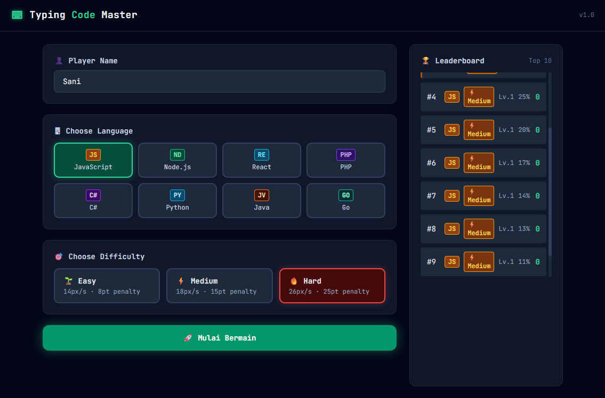
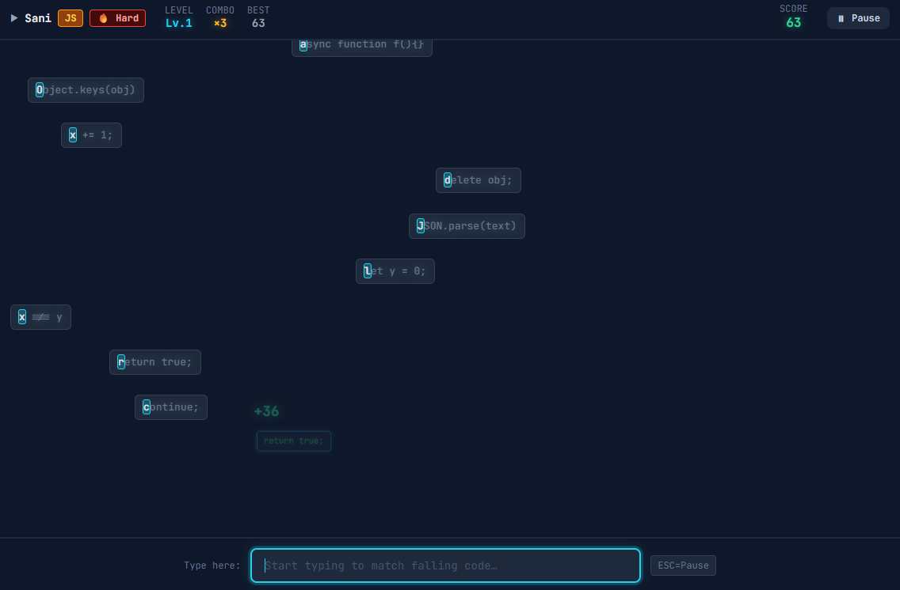
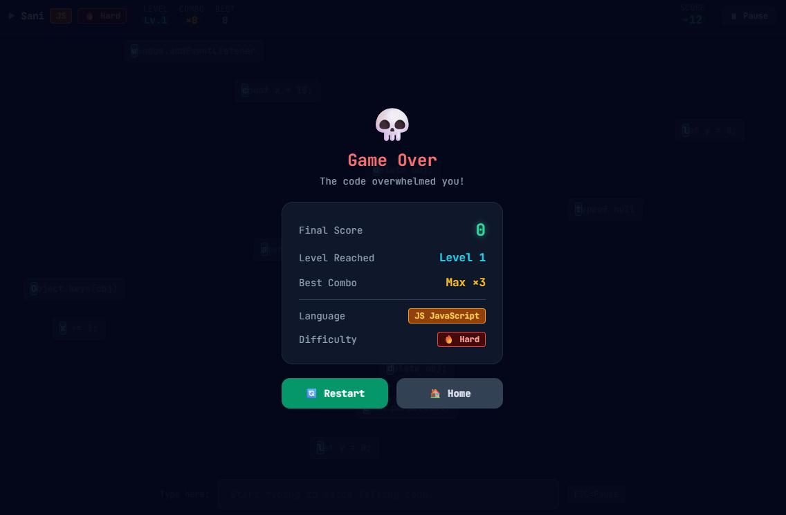

# ⌨ Typing Code Master

> Sebuah game typing berbasis browser di mana sintaks kode sungguhan jatuh dari layar — ketik secepat mungkin sebelum mereka menyentuh batas bawah!

Apliaksi game ini dibuat dengan konsep Vibe Coding menggunakan IBM Bob dan merupakan Capstone Project Program IBM Skillsbuild University Education Hacktiv8 x IBM untuk Uniuversitas Siber Asia.

---

## 🚀 Cara Menjalankan

Tidak diperlukan instalasi, build tool, atau server. Cukup:

```
Buka index.html di browser
```

Semua dependensi (Tailwind CSS, JetBrains Mono) dimuat via CDN secara otomatis.

---

## 📁 Struktur File

```
Typing-Code-Master/
├── index.html       — Struktur halaman dan semua layar UI
├── style.css        — Animasi keyframe, efek glow, dan visual khusus
├── script.js        — Seluruh logika game (tanpa data sintaks)
└── syntax-bank.js   — Data sintaks dan konfigurasi bahasa (dimuat sebelum script.js)
```

> **Penting:** `syntax-bank.js` harus selalu dimuat **sebelum** `script.js` di `index.html`, karena `script.js` bergantung pada objek global `SYNTAX_BANK` dan `LANG_CONFIG`.

---

## 🎮 Cara Bermain

1. **Masukkan username** (maks. 20 karakter).
2. **Pilih bahasa pemrograman** dari 8 pilihan yang tersedia.
3. **Pilih tingkat kesulitan** — Easy, Medium, atau Hard.
4. Klik **🚀 Mulai Bermain** (aktif setelah bahasa dan kesulitan dipilih).
5. Sintaks kode akan jatuh dari atas. **Ketik sintaks tersebut secara lengkap dan tepat** di kolom input.
6. Sistem secara otomatis **mengunci target** — token yang paling mendekati batas bawah dan awalannya cocok dengan ketikan Anda.
7. Jaga agar score tidak turun ke bawah 0, atau **Game Over!**

**Keyboard shortcut:** `Escape` untuk jeda / lanjut.

---

## 🚀 Screenshoot dan Demo

Demo: [https://marsanix.github.io/Typing-Code-Master/](https://marsanix.github.io/Typing-Code-Master/)





---

## 🏗 Arsitektur & Desain Kode

### Layer 1 — Peran & Konteks (Role & Context)

Proyek ini dibangun menggunakan pendekatan **Senior Frontend Engineer**: kode bersih, modular, dan langsung dapat dijalankan di browser tanpa langkah build. Stack yang digunakan:

| Teknologi | Peran |
|---|---|
| **HTML5 Semantik** | Struktur halaman (`<main>`, `<header>`, `<section>`, `<footer>`, `<aside>`) |
| **Tailwind CSS via CDN** | Styling utama dan layout responsif |
| **Vanilla JavaScript ES6+** | Logika game murni — tanpa framework |
| **JetBrains Mono** | Font monospace untuk semua teks sintaks dan input |

### Layer 2 — Fitur & Mekanika (Task & Requirements)

#### A. Layar Profil & Pemilihan Sesi
- Input username dengan validasi real-time.
- **8 bahasa pemrograman** ditampilkan sebagai chip visual (grid 4 kolom) dengan ikon dan warna badge unik per bahasa.
- **3 tingkat kesulitan** (🌱 Easy, ⚡ Medium, 🔥 Hard) dengan parameter kecepatan, penalti, dan grace period berbeda.
- Tombol "Mulai Bermain" hanya aktif setelah ketiganya (nama + bahasa + kesulitan) terisi.
- **Leaderboard lokal** top-10 dengan badge bahasa, badge kesulitan, akurasi, dan level — disimpan di `localStorage`.

#### B. Mekanika Gameplay (Syntax Jatuh)

```
spawnToken()  →  gameLoop() [requestAnimationFrame]  →  onInputChange()
     ↓                 ↓                                      ↓
  SYNTAX_BANK    delta-time physics               resolveLock() (target locking)
  per tier       miss detection                   renderTokenHighlight()
```

- Sintaks dari `SYNTAX_BANK` dipilih acak dari pool aktif sesuai **level + difficulty** (tier 1/2/3 unlock bertahap).
- **Target Locking** (`resolveLock()`): saat pemain mulai mengetik, sistem mengunci token yang awalannya cocok — prioritas token paling bawah (paling berbahaya). Lock tidak berpindah acak.
- **Berhasil:** token hilang dengan animasi sukses, poin = `panjang sintaks × combo multiplier` (max ×8).
- **Gagal (miss):** token jatuh → penalti poin → combo reset → flash merah. Skor < 0 = Game Over.
- Level naik tiap **200 poin**; kecepatan dan interval spawn menyesuaikan otomatis.

#### C. HUD & Alur Layar

```
Profil  ──►  Bermain  ──►  Jeda (Pause)
                │                │
                ▼           (resume/ESC)
            Game Over  ◄────────────
                │
          Restart / Home
```

HUD menampilkan: nama pemain, badge bahasa & kesulitan, Level, Combo (×N), Hi-Score, Score saat ini.

#### D. Penyimpanan

- Leaderboard disimpan di `localStorage` dengan key `tcm_leaderboard`.
- Hi-score dibandingkan **per kombinasi** nama + bahasa + kesulitan.
- Akurasi dihitung dari `tokensHit / (tokensHit + tokensMissed) × 100`.

#### E. Parameter Difficulty

| Parameter | 🌱 Easy | ⚡ Medium | 🔥 Hard |
|---|---|---|---|
| `baseSpeed` | 14 px/s | 18 px/s | 26 px/s |
| `speedPerLevel` | +3 | +4 | +6 |
| `spawnInterval` awal | 4500 ms | 3500 ms | 2200 ms |
| `minSpawnInterval` | 1500 ms | 1000 ms | 700 ms |
| `gracePeriod` | 6000 ms | 5000 ms | 3000 ms |
| `penaltyPoints` | 8 | 15 | 25 |
| Tier 2 muncul mulai | Level 3 | Level 2 | Level 1 |
| Tier 3 muncul mulai | Level 6 | Level 4 | Level 2 |

### Layer 3 — Constraint & Implementasi (Constraints & Output)

#### Arsitektur Modular (`script.js`)

| Objek / Fungsi | Tanggung Jawab |
|---|---|
| `DIFFICULTY_CONFIG` | Konfigurasi semua parameter per difficulty |
| `Storage` | Baca/tulis `localStorage`, hitung hi-score per kombinasi |
| `State` | Satu sumber kebenaran untuk seluruh state sesi bermain |
| `DOM` | Referensi semua elemen DOM, diinisialisasi sekali di `init()` |
| `gameLoop()` | RAF loop — gerak token, deteksi miss, grace period |
| `spawnToken()` | Pilih sintaks dari pool aktif, buat elemen DOM token |
| `resolveLock()` | Target locking — cari token terbaik untuk dikunci |
| `onInputChange()` | Proses input pemain, update highlight, cek full match |
| `renderTokenHighlight()` | Render span per karakter: matched / cursor / pending |
| `awardSuccess()` | Tambah skor, combo, animasi sukses, score burst |
| `applyMissPenalty()` | Kurangi skor, reset combo, miss flash, cek game over |
| `getActiveSyntaxPool()` | Bangun pool sintaks sesuai level + tier unlock |

#### Bank Sintaks (`syntax-bank.js`)

```js
SYNTAX_BANK = {
  javascript: {
    tier1: [ /* ≤15 karakter */ ],
    tier2: [ /* 16–30 karakter */ ],
    tier3: [ /* 31+ karakter */ ],
  },
  nodejs: { ... },
  react:  { ... },
  // ... 8 bahasa total
}

LANG_CONFIG = {
  javascript: { label, icon, badgeClass },
  // ...
}
```

#### Visual & UI/UX

- **Tema:** Dark mode — `#0f172a` (obsidian) / `#1e293b` (slate) dengan aksen emerald, cyan, amber.
- **Warna badge bahasa:** JS→amber · Node→emerald · React→cyan · PHP→violet · C#→purple · Python→sky · Java→orange · Go→teal
- **Warna badge difficulty:** Easy→emerald · Medium→amber · Hard→red
- **Animasi token:** `anim-spawn` (fade+slide masuk) · `anim-success` (scale+brighten+fade hijau) · `anim-miss` (shake+fade merah)
- **Efek khusus:** Miss flash merah full-screen · Floating `+N` score burst · Combo pop pulse pada HUD
- **Responsif mobile-first:** Semua layar rapi di layar kecil maupun besar.

---

## 🌐 Bahasa yang Didukung

| Bahasa | Icon | Warna |
|---|---|---|
| JavaScript | `JS` | Amber |
| Node.js | `ND` | Emerald |
| React | `RE` | Cyan |
| PHP | `PHP` | Violet |
| C# | `C#` | Purple |
| Python | `PY` | Sky |
| Java | `JV` | Orange |
| Go | `GO` | Teal |

---

## 🔢 Sistem Poin

```
Poin per token = panjang sintaks (karakter) × combo multiplier

Combo multiplier: ×1 → ×2 → ... → ×8 (maksimum)
Combo reset setiap kali token jatuh melewati batas bawah.

Level naik tiap 200 poin akumulasi.
```

---

## 🛠 Teknologi

- **HTML5** — Elemen semantik (`<main>`, `<section>`, `<header>`, `<footer>`, `<aside>`)
- **Tailwind CSS** `v3` via CDN — utility-first styling
- **Vanilla JavaScript** ES6+ — `const/let`, arrow functions, destructuring, template literals, `requestAnimationFrame`
- **Web Storage API** — `localStorage` untuk persistensi leaderboard
- **Google Fonts** — JetBrains Mono (via `@import` di `style.css`)

---

## 📜 Lisensi

Proyek ini dibuat sebagai bagian dari **IBM SkillsBuild Capstone Project**.  
Bebas digunakan untuk keperluan pembelajaran dan portofolio.
